# GitHub Actions Self-Hosted Runner

A minimal Node.js + Express project that runs its CI pipeline on a **self-hosted Windows runner** instead of GitHub-hosted machines, with a locked-down, least-privilege workflow.


[](https://github.com/KARTHIKAKRISHNA123/github-actions-self-hosted-runner/actions/workflows/cicd.yml)

## Contents

- [Screenshots](#screenshots)
- [Problem Statement](#problem-statement)
- [Solution Overview](#solution-overview)
- [Key Features](#key-features)
- [Architecture](#architecture)
- [Technology Stack](#technology-stack)
- [Request Lifecycle](#request-lifecycle)
- [Data Flow](#data-flow)
- [UML Diagrams](#uml-diagrams)
- [Data Flow Diagrams](#data-flow-diagrams)
- [Folder Structure](#folder-structure)
- [Prerequisites](#prerequisites)
- [Installation](#installation)
- [Environment Variables](#environment-variables)
- [Configuration Guide](#configuration-guide)
- [API Documentation](#api-documentation)
- [Authentication Flow](#authentication-flow)
- [Security Considerations](#security-considerations)
- [Performance and Scalability](#performance-and-scalability)
- [Deployment Guide](#deployment-guide)
- [CI/CD Workflows](#cicd-workflows)
- [Testing Strategy](#testing-strategy)
- [Error Handling and Logging](#error-handling-and-logging)
- [Engineering Decisions and Tradeoffs](#engineering-decisions-and-tradeoffs)
- [Troubleshooting](#troubleshooting)
- [FAQ](#faq)

## Screenshots

> *Add screenshots here. Suggested captures, saved under `docs/images/`:*
> *1. Repository Settings, Actions, Runners page showing the runner as Idle or Active.*
> *2. A green "Trusted Windows CI" run with all steps expanded.*
> *3. The runner terminal showing "Listening for Jobs" and a job being picked up.*
> *4. A browser or API client calling the `/getSum/2/3` endpoint.*

## Problem Statement

GitHub-hosted runners are convenient but they run on machines you do not control. That is a poor fit when a pipeline needs a specific Windows environment, pre-installed tooling, access to local resources, or no per-minute billing. Moving to self-hosted hardware solves those problems but introduces a new one: the runner executes workflow code on your own machine, so a careless workflow becomes a way into that machine.

## Solution Overview

This repository demonstrates both halves of the problem:

1. **Registering a Windows x64 machine as a self-hosted runner** (runner agent 2.338.2) and routing a workflow to it with `runs-on: [self-hosted, Windows, X64]`.
2. **Hardening that workflow** so the machine is exposed as little as possible: push-only trigger on `main`, read-only token, no persisted git credentials, a commit-SHA-pinned checkout action, serialized runs, and a job timeout.

The payload being built and tested is deliberately small: an Express 5 server with a `sum` function and three Jest tests. The interesting part is the pipeline, not the app.

## Key Features

| Feature | Detail | Where |
|---|---|---|
| Self-hosted Windows execution | Job targets labels `self-hosted`, `Windows`, `X64` | `.github/workflows/cicd.yml` |
| Least-privilege token | `permissions: contents: read` | `cicd.yml` |
| No persisted credentials | `persist-credentials: false` on checkout | `cicd.yml` |
| Supply-chain pinning | `actions/checkout` pinned to a full commit SHA | `cicd.yml` |
| Environment gate | Fails fast unless Node.js major version is 22 | `cicd.yml`, "Check Windows Environment" step |
| Serialized runs | `concurrency` group with `cancel-in-progress: true` | `cicd.yml` |
| Bounded runtime | `timeout-minutes: 20` | `cicd.yml` |
| Secrets kept out of git | Runner credentials and binaries are git-ignored | `.gitignore` |
| Parallel hosted pipeline | Standard Node.js CI on `ubuntu-latest`, Node 22.x | `.github/workflows/ci.yml` |
| Tiny REST API | `GET /home` and `GET /getSum/:a/:b` | `server.js` |

## Architecture

### Overall Architecture

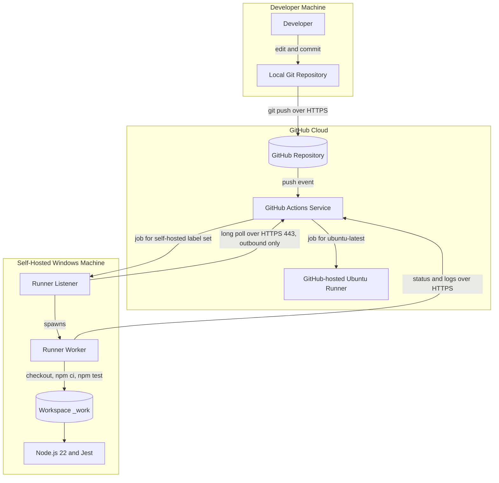

### System Architecture

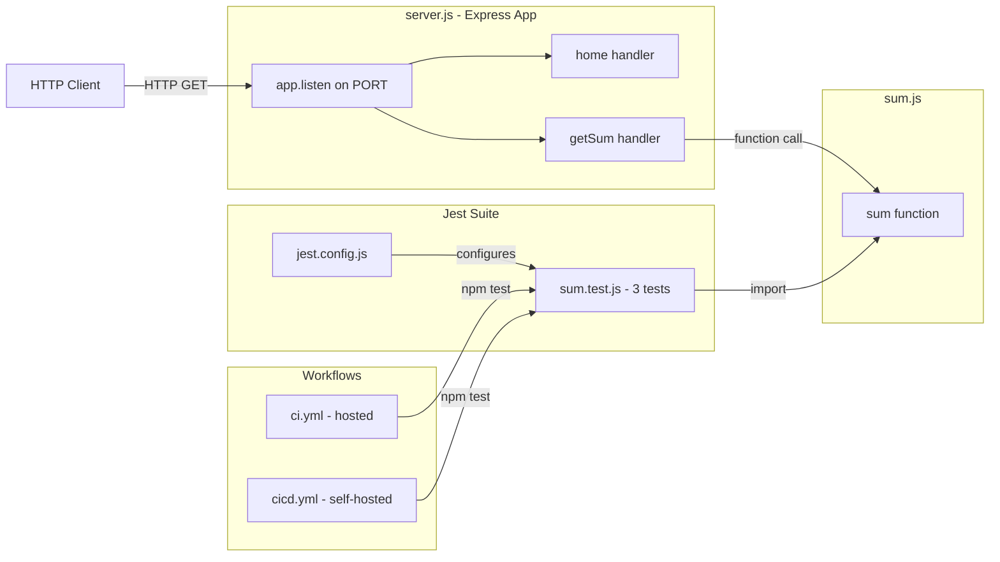

## Technology Stack

> Every library, framework, tool and service used. "Why Chosen" is inferred from the project structure, not stated by the author.

| Technology / Package | Version | Category | Purpose in Project | Why Chosen | Key Features Used |
|---|---|---|---|---|---|
| Node.js | 22.x (enforced in `cicd.yml`, matrix in `ci.yml`) | Runtime | Executes the server and the test runner | Current LTS-line runtime, native ES module support | `"type": "module"`, `--experimental-vm-modules` flag |
| npm | — | Package Manager | Installs dependencies, runs the `test` script | Ships with Node, lockfile support | `npm ci` for reproducible installs, `npm test` |
| Express | 5.3.0 | Backend Framework | HTTP server and routing | Minimal, unopinionated | `app.get`, route params (`:a`, `:b`), `res.json` |
| Jest | 30.5.2 | Testing | Unit tests for `sum()` | Zero-config test runner with built-in assertions | `describe`, `test`, `expect().toBe()`, `testEnvironment: node` |
| Nodemon | 3.1.14 | Dev Tool | Auto-restart on file change | Faster local iteration | Installed but not wired to any npm script (see [Engineering Decisions](#engineering-decisions-and-tradeoffs)) |
| ES Modules | — | Language Feature | `import` and `export default` across files | Modern standard, no transpiler needed | `import sum from "./sum.js"` |
| GitHub Actions | — | CI/CD Platform | Orchestrates both workflows | Native to the repository | `on: push`, `permissions`, `concurrency`, `timeout-minutes` |
| GitHub Actions Runner | 2.338.2 (from the local archive name) | CI Agent | Self-hosted executor on the Windows machine | Required to run jobs on your own hardware | Listener, Worker, `config.cmd`, `run.cmd`, optional Windows service |
| actions/checkout | Pinned to a full commit SHA | Workflow Action | Fetches the repository into the workspace | SHA pinning prevents a moved tag from changing what runs | `persist-credentials: false` |
| actions/setup-node | v4 | Workflow Action | Installs Node and caches npm (hosted pipeline only) | Standard Node setup action | `node-version` matrix, `cache: npm` |
| PowerShell 7 (`pwsh`) | — | Shell | Runs the environment-check step | Explicit Windows scripting with `throw` for hard failure | `node --version` regex match |
| Windows x64 host | — | Infrastructure | The machine the runner runs on | Target platform for Windows-specific CI | Matched through the `Windows` and `X64` labels |
| .NET runtime (bundled) | 8.x | Runner Dependency | Runs the runner agent itself | Shipped inside the runner package | Inferred from the `bin/` contents; no separate install needed |

## Request Lifecycle

### Request 1: Read, `GET /getSum/2/3`

```
1. CLIENT
   └── Browser or API client sends: GET http://localhost:8000/getSum/2/3

2. ENTRY POINT  (server.js)
   └── Express app created with express(); listening on process.env.PORT or 8000
       → No body parser, CORS, logging or auth middleware is registered

3. ROUTING  (server.js)
   └── Route pattern /getSum/:a/:b matches
       → req.params = { a: "2", b: "3" }   (route params are always strings)

4. HANDLER  (server.js)
   └── const { a, b } = req.params
       → Number(a), Number(b) converts to 2 and 3

5. BUSINESS LOGIC  (sum.js)
   └── sum(2, 3) returns 5

6. RESPONSE  (server.js)
   └── res.json({ ans: 5 })  →  HTTP 200, Content-Type: application/json

ERROR PATHS
   ├── Non-numeric input, e.g. /getSum/x/3
   │     Number("x") is NaN, sum returns NaN, JSON serialization turns NaN into null
   │     Response: 200 {"ans":null}   (no validation, no 400)
   └── Unknown route
         Express default handler returns 404
```

### Request 2: Read, `GET /home`

```
CLIENT → Express router matches /home → handler in server.js
       → res.json({ msg: "Welcome to the home page!" })  →  HTTP 200
```

### Pipeline Lifecycle: `git push` to `main` (self-hosted job)

```
1. DEVELOPER
   └── git push origin main

2. GITHUB
   └── Evaluates every workflow with an "on: push" trigger for branch main
       → ci.yml (hosted) and cicd.yml (self-hosted) both match, so two runs start
       → concurrency group "windows-self-hosted-ci" cancels any older in-flight cicd.yml run

3. JOB ROUTING
   └── cicd.yml job "build" requires labels [self-hosted, Windows, X64]
       → Job waits in Queued until a runner with all three labels is online

4. RUNNER LISTENER  (bin/Runner.Listener.exe)
   └── Long-polls GitHub over HTTPS, receives the job, launches the Worker

5. RUNNER WORKER  (bin/Runner.Worker.exe)
   └── Executes the steps in the workspace under _work/

6. STEPS
   ├── Checkout Source Code      actions/checkout@<pinned SHA>, persist-credentials: false
   ├── Check Windows Environment pwsh: prints hostname, node and npm versions,
   │                             throws if node --version does not match ^v22\.
   ├── Install Dependencies      npm ci
   ├── Build Application         npm run build --if-present   (no build script exists, so a no-op)
   └── Run Tests                 npm test  →  node --experimental-vm-modules jest

7. RESULT
   └── Worker uploads logs and status to GitHub; the run turns green or red

ERROR PATHS
   ├── No matching runner online  → job stays Queued
   ├── Wrong Node major version   → "Node.js 22 is required on this runner." and the job fails
   ├── Any step exits non-zero    → job fails, later steps are skipped
   └── Job exceeds 20 minutes     → job is cancelled by timeout-minutes
```

## Data Flow

This project is **stateless**. There is no database, cache, session store, frontend state or ML model.

### API Data Flow

```
URL path segments (strings)
  → Express req.params
  → Number() coercion in the handler  (the only data transformation)
  → sum(a, b) pure function
  → res.json() serializes the result
  → HTTP response body
```

### Pipeline Data Flow

```
Source commit (GitHub)
  → actions/checkout writes files into _work/<repo>/<repo>
  → npm ci reads package-lock.json, writes node_modules inside the workspace
  → Jest reads *.test.js, imports sum.js, evaluates assertions
  → exit code + console output
  → Runner Worker packages logs and conclusion
  → GitHub Actions UI
```

### Error Propagation

```
Assertion fails or step exits non-zero
  → Worker marks the step failed and skips the rest
  → Job conclusion = failure
  → Run shows red in the Actions tab and on the commit
```

## UML Diagrams

<details>
<summary>UML Diagrams - Full Suite (9 Diagrams plus Swimlane)</summary>

> The project has no classes in the object-oriented sense, so modules and configuration files are modelled as classes where a diagram type requires them.

### 1. Use Case Diagram

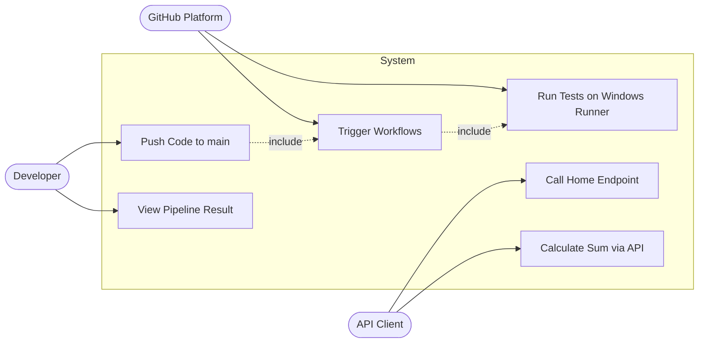

### 2. Class Diagram

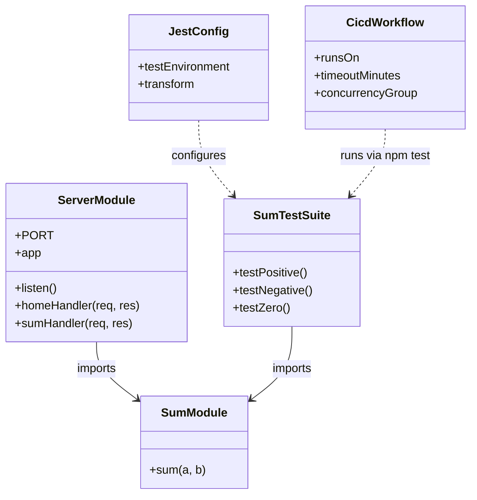

### 3. Sequence Diagram

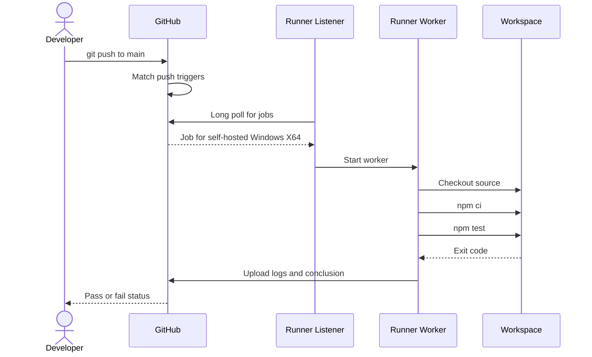

### 4. Collaboration Diagram

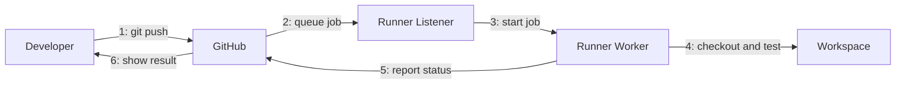

### 5. Activity Diagram

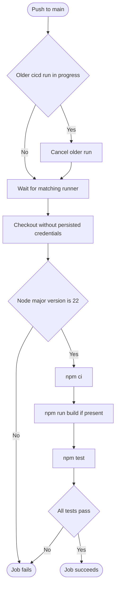

### 6. State Diagram

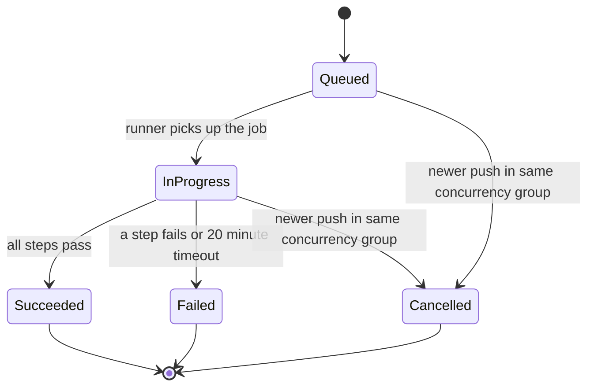

### 7. Component Diagram

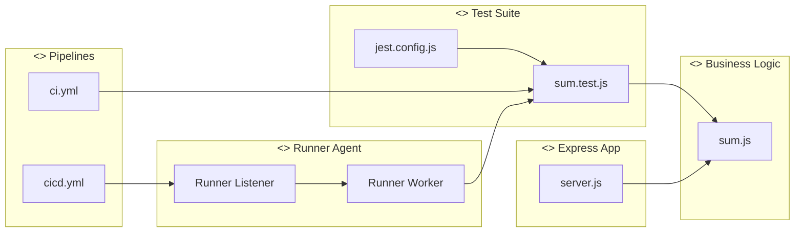

### 8. Deployment Diagram

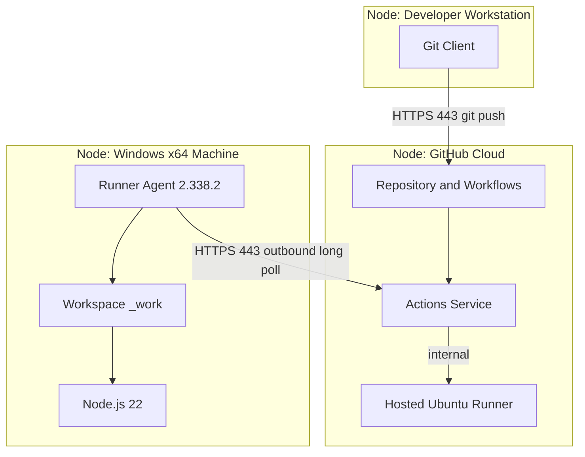

### 9. Package Diagram

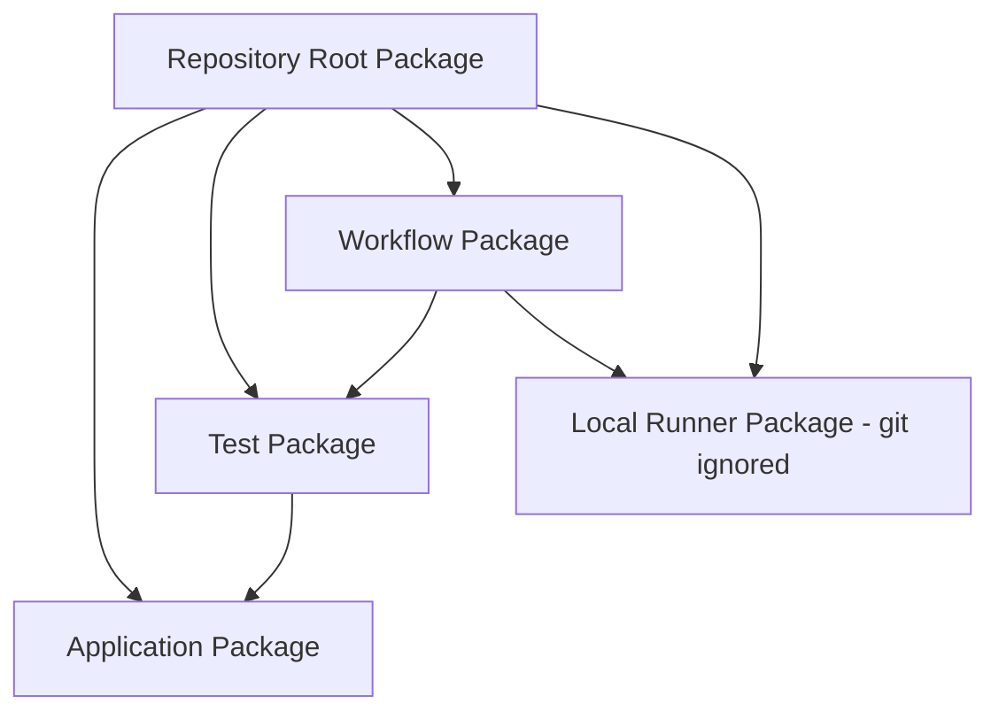

### Swimlane Diagram

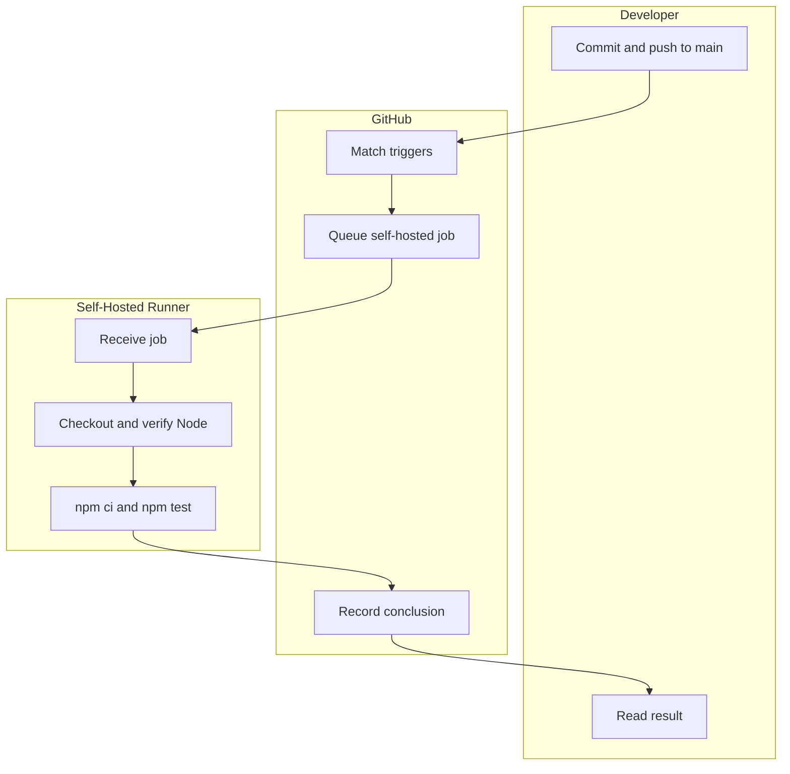

</details>

## Data Flow Diagrams

<details>
<summary>Data Flow Diagrams - Level 0 and Level 1</summary>

> The DFDs describe the CI system (workflow plus runner). The Express API is a standalone local process and is covered in [Request Lifecycle](#request-lifecycle).

### DFD Level 0 (Context)

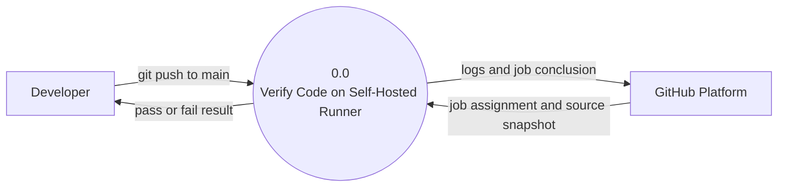

### DFD Level 1

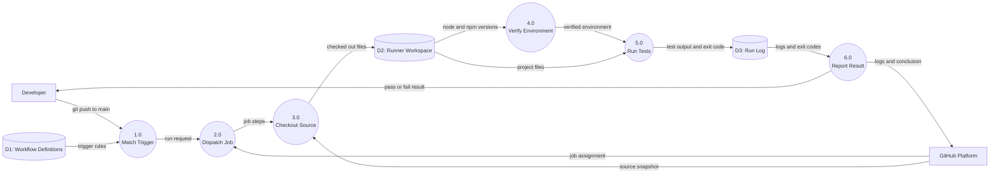

</details>

## Folder Structure

```
github-actions-self-hosted-runner/
├── .github/
│   └── workflows/
│       ├── ci.yml            # Node.js CI on ubuntu-latest, Node 22.x, push and PR to main
│       └── cicd.yml          # Trusted Windows CI on the self-hosted runner, push to main only
├── server.js                 # Express app: GET /home and GET /getSum/:a/:b
├── sum.js                    # sum(a, b), default export
├── sum.test.js               # 3 Jest tests for sum()
├── jest.config.js            # node test environment, transform disabled for native ESM
├── package.json              # ESM project, "test" script, 3 dependencies
├── package-lock.json         # Lockfile used by npm ci
├── .gitignore                # Excludes runner credentials, binaries and workspace
└── README.md

Local only (git-ignored, never committed):
├── .credentials              # Runner credentials
├── .credentials_rsaparams    # Runner RSA key parameters
├── .runner                   # Runner registration settings
├── config.cmd, run.cmd       # Runner configure and run scripts
├── bin/, externals/          # Runner binaries and bundled Node runtimes
├── actions-runner/           # Placeholder folder
├── _work/                    # Job workspaces and downloaded actions
├── _diag/                    # Runner diagnostic logs
└── actions-runner-win-x64-2.338.2.zip
```

## Prerequisites

| Requirement | Why |
|---|---|
| Windows 10, 11 or Server, x64 | Matches the `Windows` and `X64` runner labels |
| Node.js 22.x on the runner and locally | `cicd.yml` fails the job on any other major version |
| npm | Installs dependencies |
| Git | Clone and push |
| PowerShell 7 (`pwsh`) on the runner | The environment-check step uses `shell: pwsh` |
| Admin access to the GitHub repository | Needed to create a runner registration token |
| Outbound HTTPS (443) from the runner | The runner polls GitHub; no inbound ports are required |

## Installation

### 1. Run the app locally

```powershell
git clone https://github.com/KARTHIKAKRISHNA123/github-actions-self-hosted-runner.git
cd github-actions-self-hosted-runner
npm ci
node server.js
```

The server listens on port 8000 by default. Try it:

```powershell
curl http://localhost:8000/home
curl http://localhost:8000/getSum/2/3
```

### 2. Register the Windows self-hosted runner

1. In the repository go to **Settings, Actions, Runners, New self-hosted runner** and choose **Windows, x64**. That page shows the current download URL and a one-time registration token.
2. In PowerShell, in the folder where the runner should live:

```powershell
mkdir actions-runner; cd actions-runner
Invoke-WebRequest -Uri <download-url-from-the-github-page> -OutFile actions-runner-win-x64-2.338.2.zip
Add-Type -AssemblyName System.IO.Compression.FileSystem
[System.IO.Compression.ZipFile]::ExtractToDirectory("$PWD\actions-runner-win-x64-2.338.2.zip", "$PWD")

.\config.cmd --url https://github.com/KARTHIKAKRISHNA123/github-actions-self-hosted-runner --token <REGISTRATION_TOKEN>
.\run.cmd
```

3. The runner appears under Settings, Actions, Runners with the labels `self-hosted`, `Windows`, `X64`. Status **Idle** means it is ready.

Registration tokens expire after about an hour and must never be committed.

To run the agent as a Windows service instead of a console window, answer yes to the service prompt in `config.cmd` or pass `--runasservice`.

To remove the runner: `.\config.cmd remove --token <REMOVAL_TOKEN>`.

## Environment Variables

| Variable | Default | Used By | Description |
|---|---|---|---|
| `PORT` | `8000` | `server.js` | TCP port the Express server listens on |
| `GITHUB_TOKEN` | Injected by GitHub | Workflows | Short-lived job token, limited to `contents: read` in `cicd.yml` |

There is no `.env.example`. `.gitignore` already excludes `.env` and `.env.*` for when one is added.

## Configuration Guide

| Setting | File | Effect |
|---|---|---|
| `runs-on: [self-hosted, Windows, X64]` | `cicd.yml` | Job only runs on a runner that has all three labels |
| `on: push: branches: [main]` | `cicd.yml` | Pull requests do not run on the self-hosted runner |
| `permissions: contents: read` | `cicd.yml` | Token cannot write to the repository |
| `concurrency.cancel-in-progress: true` | `cicd.yml` | A newer push cancels the older run in the same group |
| `timeout-minutes: 20` | `cicd.yml` | Hard stop for hung jobs |
| `matrix.node-version: [22.x]` | `ci.yml` | Node version for the hosted pipeline |
| `testEnvironment: "node"`, `transform: {}` | `jest.config.js` | Node globals, no Babel so native ESM works |
| `"test": "node --experimental-vm-modules ./node_modules/jest/bin/jest.js"` | `package.json` | Enables ESM support inside Jest |

## API Documentation

| Method | Route | Description | Example Response |
|---|---|---|---|
| GET | `/home` | Welcome message | `{ "msg": "Welcome to the home page!" }` |
| GET | `/getSum/:a/:b` | Adds two numbers | `/getSum/2/3` returns `{ "ans": 5 }` |

Notes: parameters are converted with `Number()` and not validated. Non-numeric input returns `{ "ans": null }` with status 200. No authentication, no rate limiting, no request logging.

There is no database in this project, so there is no schema, and no frontend, so there is no component or state-management layer.

## Authentication Flow

Runner registration and job authorization, at a high level (per GitHub's runner behaviour; token and key exchange details are handled by the runner agent):

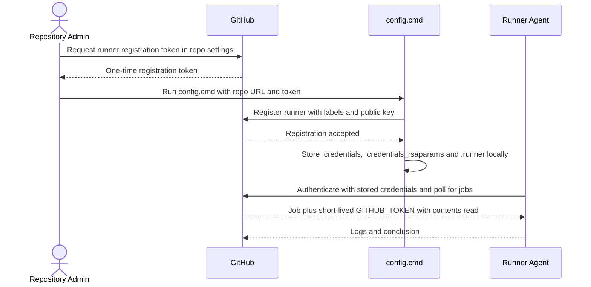

The API itself has no authentication.

## Security Considerations

A self-hosted runner executes repository-supplied code on your own machine. The workflow is built around that risk.

| Threat | Mitigation in this repo |
|---|---|
| Untrusted pull request code running on your machine | `cicd.yml` triggers on `push` to `main` only, never on `pull_request`. The hosted `ci.yml` handles pull requests. |
| Stolen or over-powered job token | `permissions: contents: read` |
| Git credentials left on disk after checkout | `persist-credentials: false` |
| Tampered or moved action tag | `actions/checkout` pinned to a full commit SHA |
| Runner secrets committed by accident | `.credentials`, `.credentials_rsaparams`, `.runner`, `bin/`, `externals/`, `_work/`, `_diag/` and `*.zip` are git-ignored |
| Registration token leakage | Token is entered at the command line only and expires in about an hour |
| Wrong toolchain silently used | Environment gate throws unless Node major version is 22 |
| Runaway or overlapping jobs | 20 minute timeout, concurrency group with cancel-in-progress |
| Inbound attack surface | None required; the runner makes outbound HTTPS connections only |

Residual risks to keep in mind:

- Anyone with write access to `main` can run code on the runner.
- The runner holds long-lived credentials on disk. Protect the machine and run the service under a low-privilege account.
- Keep the runner updated; GitHub requires reasonably current runner versions.
- If this repository ever becomes public, do not enable self-hosted jobs for fork pull requests.

## Performance and Scalability

- `npm ci` gives fast, reproducible installs from `package-lock.json`.
- The hosted pipeline caches npm through `actions/setup-node` (`cache: npm`); the self-hosted job relies on the machine's own npm cache.
- `cancel-in-progress` avoids wasting runner time on superseded commits.
- Throughput is limited to one runner. The concurrency group also serializes `cicd.yml` runs. To scale out, register more runners with the same labels and relax or shard the concurrency group.

## Deployment Guide

This repository builds and tests; it does not deploy. To run the app on a server:

```powershell
npm ci
$env:PORT = 8000
node server.js
```

For a long-running process use a process manager or Windows service wrapper. There is no Dockerfile in the project.

## CI/CD Workflows

| | `ci.yml` (Node.js CI) | `cicd.yml` (Trusted Windows CI) |
|---|---|---|
| Runs on | `ubuntu-latest` (GitHub-hosted) | `[self-hosted, Windows, X64]` |
| Triggers | push and pull request to `main` | push to `main` only |
| Node setup | `actions/setup-node@v4`, 22.x, npm cache | Pre-installed on the runner, verified to be 22.x |
| Checkout | `actions/checkout@v4` | `actions/checkout` pinned to a commit SHA, no persisted credentials |
| Permissions | Defaults | `contents: read` |
| Concurrency and timeout | None | Serialized group, 20 minutes |
| Steps | `npm ci`, `npm run build --if-present`, `npm test` | Environment check, `npm ci`, `npm run build --if-present`, `npm test` |

A push to `main` starts both workflows, so you get one hosted run and one self-hosted run per push.

## Testing Strategy

- Framework: Jest 30.5.2 with native ES modules.
- Coverage: 3 unit tests in `sum.test.js` (`1 + 2 = 3`, `1 + -4 = -3`, `0 + 0 = 0`).
- Not covered: the Express routes, the `Number()` coercion and the `NaN` case. `server.js` calls `app.listen` on import and does not export `app`, which makes route testing awkward without a refactor.
- Run locally: `npm test`.

## Error Handling and Logging

| Area | Behaviour |
|---|---|
| API input | No validation; bad input yields `{ "ans": null }` |
| API unknown route | Express default 404 |
| Server logging | One `console.log` on startup: `Server is running on port <PORT>` |
| Workflow failures | Any non-zero exit fails the job; the environment gate uses `throw` for an explicit message |
| Runner logs | Written to `_diag/` on the runner machine (git-ignored) |
| Job logs | Available in the Actions tab for each run |

## Engineering Decisions and Tradeoffs

> *Inferred from the code and workflow structure.*

| Decision | Benefit | Tradeoff |
|---|---|---|
| Separate `ci.yml` (hosted) and `cicd.yml` (self-hosted) | PRs are tested without exposing the runner | Two runs per push to `main`; the two pipelines can drift apart |
| Push-only trigger for the self-hosted job | Removes the main route for untrusted code | PRs get no Windows validation before merge |
| SHA-pinned checkout, minimal permissions, no persisted credentials | Smaller supply-chain and token-theft surface | Pinned SHA must be bumped manually |
| Hard Node 22 check in the workflow | Fails loudly on environment drift | Must be edited when the Node version changes |
| `concurrency` with `cancel-in-progress` | Saves runner time | An in-flight run is cancelled by a newer push, so intermediate commits may never finish |
| Runner installed inside the project folder | Everything in one place | Runner folders (`_work/`, `bin/`) sit next to the code and are visible to tools such as Jest; a runner directory outside the repo is cleaner |
| `nodemon` listed under `dependencies` with no script | Handy for `npx nodemon server.js` | It is a dev tool and belongs in `devDependencies`, and no `start` or `dev` script exists |
| No `build` script | Nothing to build | `npm run build --if-present` is a no-op in both workflows |

## Troubleshooting

| Symptom | Likely Cause | Fix |
|---|---|---|
| Job stays "Queued" or "Waiting for a runner" | Runner offline, or labels do not match | Start it with `.\run.cmd` (or start the service); confirm labels `self-hosted`, `Windows`, `X64` in Settings, Actions, Runners |
| "Node.js 22 is required on this runner." | Runner machine has a different Node major version | Install Node 22.x and restart the runner so it picks up the new PATH |
| `pwsh` is not recognized | PowerShell 7 not installed | Install PowerShell 7, or change the step to `shell: powershell` |
| Local `npm test` runs many extra test files | Jest scans `_work/` and `actions-runner/` inside the project folder, including the checked-out action's own tests | Add `testPathIgnorePatterns: ["/node_modules/", "/_work/", "/actions-runner/"]` to `jest.config.js`, or keep the runner outside the repo folder |
| `{"ans":null}` from `/getSum` | Non-numeric parameter became `NaN` | Validate with `Number.isNaN` and return a 400 |
| `EADDRINUSE` on start | Port 8000 is busy | Set another port: `$env:PORT = 3000` |
| `git status` shows a workflow file modified but `git diff` shows only line endings | LF vs CRLF on Windows | Add a `.gitattributes` with `* text=auto` or set `core.autocrlf` consistently |
| Registration fails with an expired token | Registration tokens last about an hour | Generate a fresh token on the Runners page |
| Two workflow runs appear for one push | Both `ci.yml` and `cicd.yml` trigger on push to `main` | Expected behaviour |

## FAQ

**Why a self-hosted runner for a project this small?**
The app is a vehicle. The point is learning how to register, secure and target a self-hosted runner.

**Why does `cicd.yml` not run on pull requests?**
Pull request code is untrusted until reviewed. Running it on your own hardware would let a contributor execute code on that machine. The hosted `ci.yml` covers pull requests safely.

**Can I use more than one runner?**
Yes. Register more machines with the same labels. Jobs go to whichever is idle, but the concurrency group still allows only one active `cicd.yml` run at a time.

**Where are the runner credentials?**
In `.credentials`, `.credentials_rsaparams` and `.runner` on the runner machine. They are git-ignored and must stay out of version control.

**Does the project need a database or environment file?**
No. The only configuration is the optional `PORT` variable.

**How do I update the runner?**
Download the newer package from the Runners page, stop the runner, extract over the folder and restart. The runner can also self-update when GitHub requires it.
